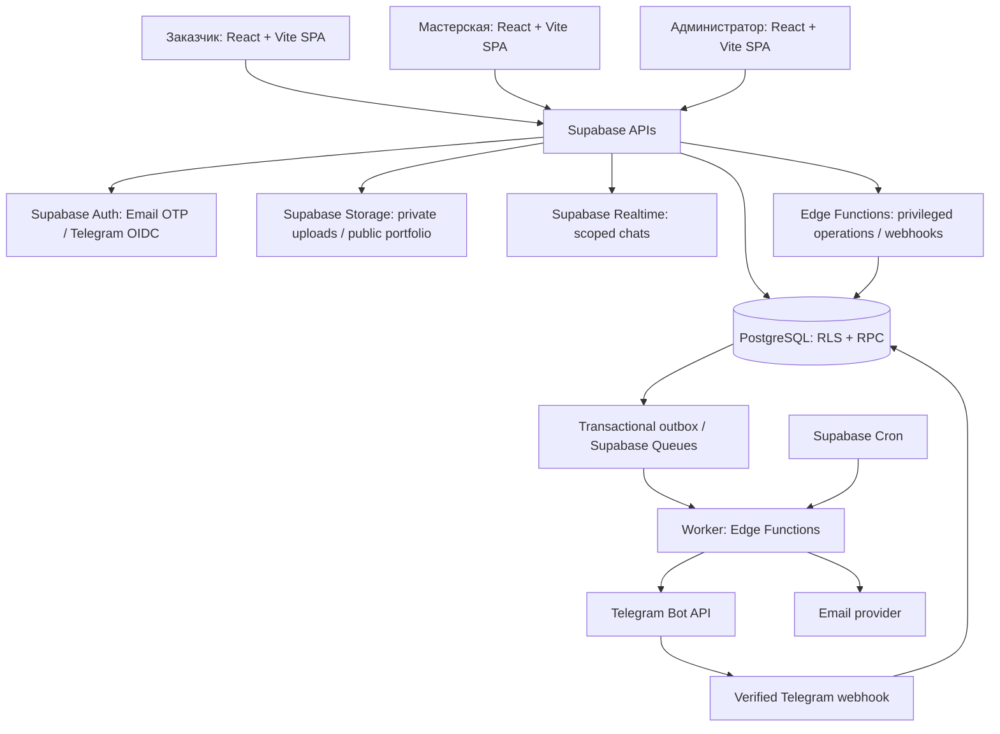
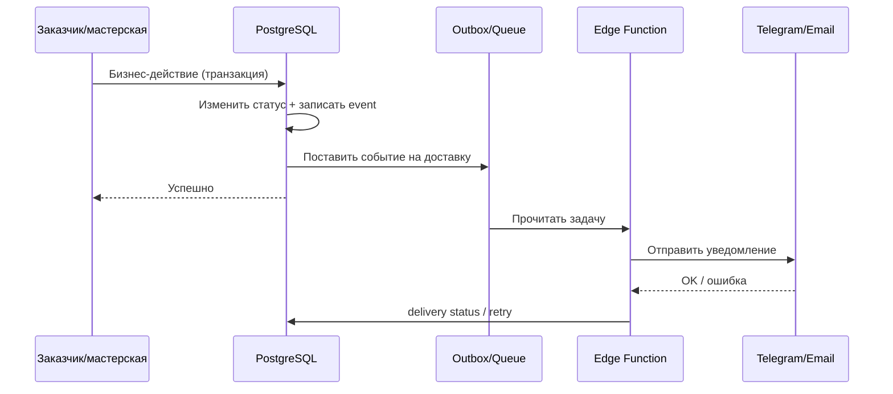

# JewelMatch AI — архитектура пилота 1.0

**Статус:** технический проект / стек React + Vite + Supabase выбран; остальные детали — предложения · **Дата:** 16.11.2026  
**Зависимость:** [JEWELMATCH_MVP_TZ_1.0.md](./JEWELMATCH_MVP_TZ_1.0.md)

> Выбранный стек зафиксирован по решению владельца проекта. Остальные инженерные детали остаются рекомендациями; текущее ТЗ — первоисточник для правил бизнеса.

## 1. Архитектурное решение

**React + Vite + Supabase**. React-приложение — клиентский интерфейс заказчика, мастерской и администратора; Supabase предоставляет Auth, PostgreSQL, Storage и Realtime. Транзакционные бизнес-операции выполняются функциями PostgreSQL (RPC), внешние интеграции, webhooks и привилегированные HTTP-операции — Supabase Edge Functions. PostgreSQL — источник истины. Для пилота не нужны отдельные микросервисы, Redis, Kubernetes или отдельная векторная БД.



### Почему такой выбор

- Один репозиторий, единая модель данных и единые проверки доступа.
- Поддерживает публикацию, частные сообщения, таймеры и подбор по простым фильтрам без избыточной инфраструктуры.
- ИИ-поиск и каталоги можно позже добавить как отдельный модуль, не меняя таблицы заказов/диалогов.
- Supabase Auth предоставляет OTP и custom OAuth/OIDC; Telegram имеет пример подключения через OIDC, где требуется опциональный email.
- Supabase Queues позволяет выполнять отправку уведомлений вне критического HTTP-запроса.

Для пилота публичные профили мастерских отдаются как часть клиентского приложения; SEO-индексация не является блокирующим требованием. Если её приоритет изменится, отдельно пересмотреть рендеринг публичных страниц.

Источники: https://vite.dev/guide/ · https://supabase.com/docs/guides/auth/custom-oauth-providers · https://supabase.com/docs/guides/database/functions · https://supabase.com/docs/guides/functions · https://supabase.com/docs/guides/queues

## 2. Карта модулей

```text
apps/web (React + Vite)
├── src/
│   ├── app/                     # приложение, провайдеры, конфигурация маршрутов
│   ├── pages/                   # экраны входа, кабинетов, диалогов и админки
│   ├── routes/                  # маршруты и защита UI-маршрутов
│   ├── components/ui/           # доступные переиспользуемые UI-компоненты
│   ├── features/                # identity, organizations, orders, chats, etc.
│   └── lib/supabase/            # browser client и типы; без service-role ключа
└── tests/e2e/
supabase/
├── migrations/                  # последовательные SQL миграции
├── functions/
│   ├── telegram-webhook/
│   ├── notifications-worker/
│   └── scheduled-worker/
├── tests/                       # pgtap / RLS / интеграционные тесты
└── seed.sql                     # безопасные справочники и тестовые данные
packages/shared/                # enums, zod-схемы и типы (опционально)
docs/
```

React Router можно использовать для клиентской навигации. Если приложение будет единственным проектом, его можно держать в корне без `apps/web`; важнее ясные границы модулей, а не монорепозиторий ради монорепозитория.

## 3. Границы доверия и серверные операции

1. Браузер предъявляет пользовательскую сессию Supabase Auth; UI-маршрут сам по себе не является границей безопасности.
2. Обычные запросы идут через Supabase API с включёнными RLS. Транзакционные бизнес-операции вызывают ограниченные PostgreSQL RPC.
3. В операции повторно проверяются права, принадлежность записи, состояние заказа и entitlement мастерской. RLS остаётся обязательной защитой строк и для запросов, пришедших не из UI.
4. Изменение данных, событие и запись outbox выполняются **в одной транзакции**.
5. Edge Functions обрабатывают webhooks, секреты и внешние интеграции; worker доставляет уведомления, фиксирует успех или повтор.

Не делегировать авторизацию простому `if (role === 'workshop')` на клиенте. Роль, принадлежность мастерской, статус модерации и подписка должны проверяться в RLS/RPC или в Edge Function перед привилегированной операцией. Service-role ключ хранится только в защищённых секретах Supabase и никогда не включается в Vite bundle.

### 3.1 Операции, требующие транзакции

- Одобрение заказа → открытие этапа → назначение новых мастерских → запись событий.
- Активация мастерской → поиск старых подходящих заказов → единичный старт trial при первом назначении.
- Выбор исполнителя → закрытие остальных диалогов текущего этапа → создание assignment.
- Отмена сотрудничества → сохранение причины, закрытие назначенной работы.
- Повторная публикация → новый round, исключения, новые приглашения, новые диалоги.
- Подтверждение работы → проверка последовательности «мастерская → заказчик» → допуск отзыва.

### 3.2 Idempotency

Для каждого критического действия вводить уникальный операционный ключ либо устойчивую уникальность в базе. Особенно для:

- Telegram webhook `update_id`;
- уведомления `(event_id, recipient_id, channel)`;
- назначения `(round_id, organization_id)`;
- чата `(round_id, organization_id)`;
- первого запуска trial `organization_id`;
- единственного отзыва `(order_id)`;
- состояния отправки и повторов background jobs.

Не полагаться на «кнопка недоступна после нажатия» — повторный запрос может прийти из сети или другого браузера.

## 4. Архитектура Auth

### Email

- Supabase Auth OTP по email; подтверждённый email привязывается к пользователю.
- Пользователь после входа, если профиль без роли, видит выбор «Заказчик» / «Мастерская».
- Выбор роли защищён от самовольной смены через произвольный UPDATE; безопасная смена роли в будущем не предусмотрена пилотом.

### Telegram Login

- В Supabase настроить Custom OAuth/OIDC provider с Telegram issuer `https://oauth.telegram.org` и `email_optional: true`.
- Использовать официальные redirect URI и state/PKCE, не принимать произвольный `telegram_user_id` из формы браузера.
- **Telegram Login** и **уведомления Telegram-бота** отдельно: для уведомлений пользователь проходит бот-команду `/start` и подтверждает привязку аккаунта токеном с ограниченным сроком действия.
- Не объединять автоматически аккаунты email/Telegram по совпадению display name.
- Тестировать выход/повторный вход, отмену Telegram login, отсутствие email, привязку/отвязку бота.

Источники: https://supabase.com/docs/guides/auth/custom-oauth-providers · https://supabase.com/docs/guides/self-hosting/self-hosted-custom-oauth-providers

## 5. Доступ к данным: таблицы, API, Storage, Realtime

### 5.1 RLS

- Включить RLS на ВСЕ таблицы, доступные через Data API.
- Явно задать grants и policies для `anon` и `authenticated`.
- Для `messages` разрешать SELECT только участникам диалога; INSERT — участникам активного диалога с дополнительной проверкой subscription для отправителя-мастерской.
- Для `conversations` мастерская видит только свой `organization_id`, заказчик — только свои заказы. Конкурент не видит даже наличие чужого диалога, если это не нужно UI.
- Для `orders` клиент читает свои черновики и заявки на модерации; мастерская — только опубликованные открытые подходящие заказы при праве доступа, плюс необходимые ей ранее назначенные/выбранные заказы для истории и подтверждения.
- Публичные профильные поля организации можно выдавать через **отдельное безопасное представление**, не отдавая PII владельца и служебные поля.
- Административные операции выполнять через ограниченные RPC или Edge Functions с проверкой роли и аудитом; не выдавать браузеру service-role ключ.

**Антирекурсия:** функции проверки принадлежности пользователя к организации не должны вызывать циклические RLS-политики. При необходимости — carefully reviewed security-definer helpers в закрытой схеме с жёстким `search_path` и грантами.

Источник: https://supabase.com/docs/guides/database/postgres/row-level-security

### 5.2 Storage

Buckets:

- `public-portfolio` — публичные фото работ с опубликованным профилем; **без** приватных данных и документов.
- `order-files` — приватные вложения заказов; доступ заказчику и допущенным исполнителям согласно этапу/правилам.
- `conversation-files` — строго приватные вложения соответствующего диалога.

**Важная развилка:** после архивирования прошлые диалоги остаются видимыми своим исходным участникам, в том числе после завершения подписки, но новые файлы загрузить нельзя. Публичные ссылки не использовать для приватных файлов. Выдавать signed URL после серверной проверки или строгой RLS policy с небольшим временем действия.

**Ключевая проверка:** наличие пути в Storage не должно означать право на скачивание. Проверять межаккаунтное чтение по API и CDN/signed URL. Не доверять только MIME из браузера. Приватные загрузки и выдачу доступа контролировать Storage policies и при необходимости Edge Function.

Источник: https://supabase.com/docs/guides/storage/security/access-control

### 5.3 Realtime

Для пилота можно выбрать Postgres Changes при низкой нагрузке и фильтрации по `conversation_id`, с обязательной проверкой RLS; на росте перейти к приватным Broadcast channels. Нельзя подписываться на чужой topic. При отзыве прав/истечении подписки серверная отправка сообщений всегда должна блокироваться независимо от возможного устаревшего состояния Realtime-подписки.

Источники: https://supabase.com/docs/guides/realtime/authorization · https://supabase.com/docs/guides/realtime/subscribing-to-database-changes

## 6. Matching: один источник истины

**Вход:** order с одобренной опубликованной ревизией и активным round.

**Последовательность:**

```text
service = order.category_id
geography = {mode, region_id, city_id}
exclude = cancelled_assignee_organization_ids(order)

eligible = active_profiles
  ∩ organizations_with_service(service)
  ∩ organizations_covering(geography)
  ∩ not_suspended
  ∩ not(exclude)
  ∩ (has_active_access OR eligible_to_start_first_trial)

for each organization in eligible:
  INSERT order_invitations ... ON CONFLICT DO NOTHING
  if this is FIRST assigned matching order:
     set trial_started_at, trial_ends_at, trial_trigger_order_id
  enqueue notification once
```

**Нюансы:**

- Пробный период запускается по назначению заявки, а не подтверждению доставки письма.
- Старые открытые заявки подбираются после активации профиля мастерской.
- Новые подходящие мастерские добавляются после одобренного редактирования заказа, но диалоги ранее подключённых мастерских не уничтожаются.
- Срок отклика заказа НЕ является фильтром доступа для новых диалогов, пока заказ открыт.
- Подписка в момент назначения и подписка в момент отправки нового сообщения могут иметь разный статус: проверять право в обеих точках.

## 7. Подписка: вычисляемые права

Не хранить изменяемую `subscription_status` как единственный критерий доступа. Вычислять entitlement из:

```text
trial_started_at, trial_ends_at,
paid_until,
suspended_at,
profile_complete
```

`can_receive_new_orders` = profile_complete AND not suspended AND (`trial not started and matching order triggers it` OR `trial active` OR `paid until future`).

`can_send_message` = own active conversation AND not suspended AND (`trial active` OR `paid active`).

`can_mark_work_done` = selected workshop for non-cancelled prior assignment, даже без активной подписки.

Отдельно по продуктовым правилам определено, что после истечения доступа мастерская видит все ранее сохранённые переписки, но не может писать. Публичная страница мастерской остаётся доступной.

**Защита от trial-reset:** организация не может самостоятельно обнулить даты или создать новую подписку из браузера. Повторные организации одного владельца — риск злоупотребления; автоматическая дедупликация в пилоте не гарантируется, потребуется мониторинг.

## 8. Очередь и уведомления



- Поддержка user preferences: Email/Telegram отключаемы по отдельности, in-app notifications всегда доступны.
- Уважать Telegram `/start` и факт привязанного чата; до него Telegram-уведомление невозможное.
- При недоступности провайдера запись остаётся в очереди до повтора или помечается ошибкой с возможностью ручного восстановления.
- В Telegram webhook проверять `X-Telegram-Bot-Api-Secret-Token` и идемпотентность `update_id`.
- Не вставлять приватные файлы и полные диалоги в email-уведомления.

Источник: https://core.telegram.org/bots/api · https://supabase.com/docs/guides/queues

## 9. Крон и истечение жизненных циклов

Периодическая задача, например раз в час [ПРЕДЛОЖЕНИЕ], проверяет:

1. истечение срока trial/оплаты: блокируются только новые заявки, чаты и новые сообщения;
2. открытую заявку без действий заказчика 30 дней: `relevance_requested_at = now()` + уведомление;
3. отсутствие реакции 7 дней после запроса актуальности: `archived`;
4. ожидание подтверждения выполнения 30 дней бездействия: `closed_unconfirmed`;
5. момент напоминания о выборе после окна отклика (либо 7 дней для бессрочного).

Нельзя закрывать подтверждённо исполняемую работу таймером, предназначенным для **открытых** заказов. Архивирование `closed_unconfirmed` не превращать в `completed`.

## 10. Тестовая стратегия

**Unit:** matching по городам, специализациям, исключениям, calculateEntitlement, сроки напоминаний и архивирования.

**DB/RLS:** cross-user select/insert/update/delete, чтение чужих вложений, admin-only actions, expiry side effects, no double assignments, no double reviews.

**Integration:** auth OTP и Telegram; moderation→publish→matching→trial; сообщения с вложениями; expired→read-only; select/cancel/reopen round; cron timers; payment activation; Telegram webhook retries.

**E2E:** mobile-first сценарии трёх ролей (заказчик, мастерская, админ); две конкурирующие мастерские на одном заказе; повторная публикация архивного заказа.

**Негативные сценарии:** конкурентная запись, повторы webhook, медленная сеть, отмена запроса на полпути, отсутствующий email у Telegram-only пользователя, оборванная загрузка, устаревший signed URL, истечение trial на открытой вкладке.

## 11. Операционная готовность

- `.env.example` содержит только имена переменных, без секретов.
- Локальный Supabase CLI + migrations + seed.
- Staging и Production раздельны.
- Критические серверные события и admin actions логируются с correlation ID.
- Мониторинг очередей и неотправленных событий; восстановление без повторных созданий заказов.
- Резервное копирование данных и проверенная процедура restore.
- Политика обработки персональных данных, правил сервиса и использования фото/дизайнов до публичного запуска.

## 12. Источники

- https://vite.dev/guide/
- https://reactrouter.com/start/declarative/routing
- https://supabase.com/docs/guides/auth
- https://supabase.com/docs/guides/auth/custom-oauth-providers
- https://supabase.com/docs/guides/self-hosting/self-hosted-custom-oauth-providers
- https://supabase.com/docs/guides/database/postgres/row-level-security
- https://supabase.com/docs/guides/database/functions
- https://supabase.com/docs/guides/functions
- https://supabase.com/docs/guides/storage/security/access-control
- https://supabase.com/docs/guides/realtime/authorization
- https://supabase.com/docs/guides/realtime/subscribing-to-database-changes
- https://supabase.com/docs/guides/queues
- https://core.telegram.org/bots/api
